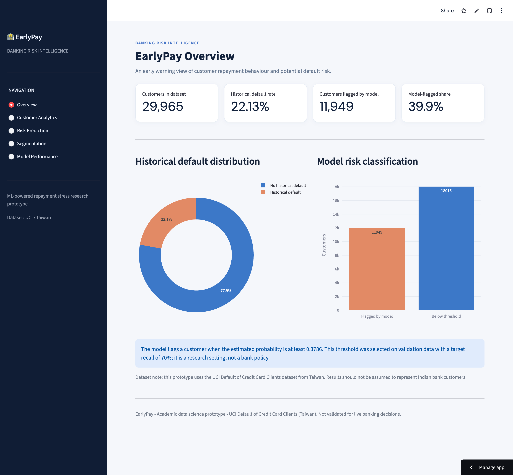
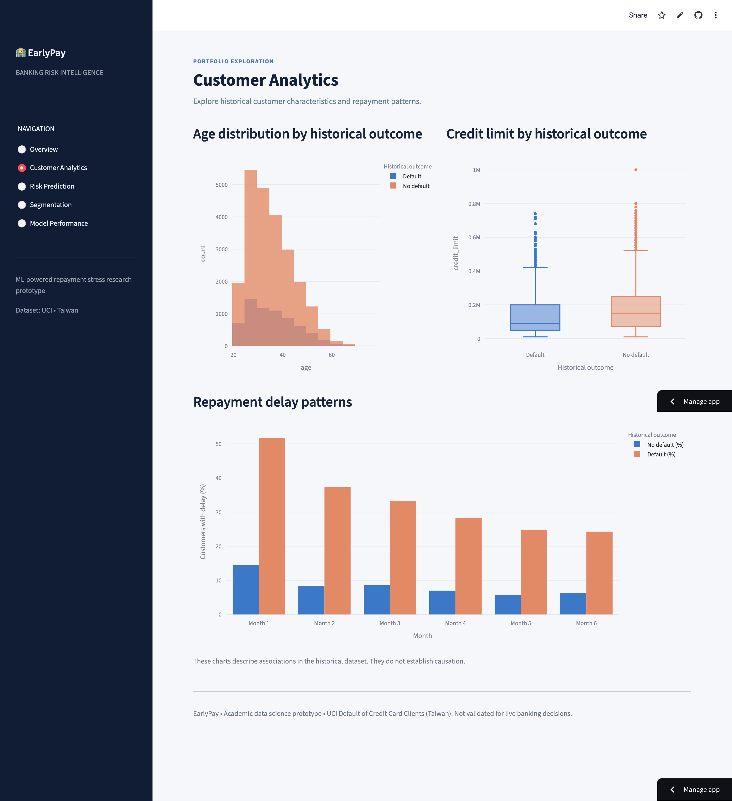
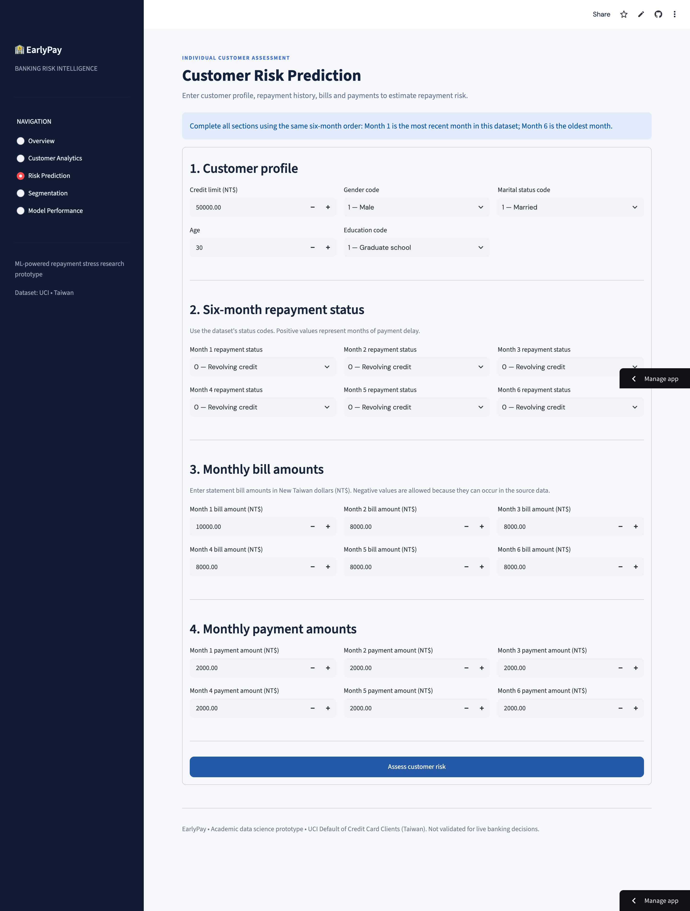
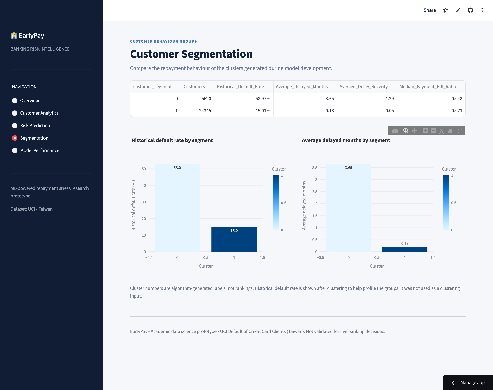
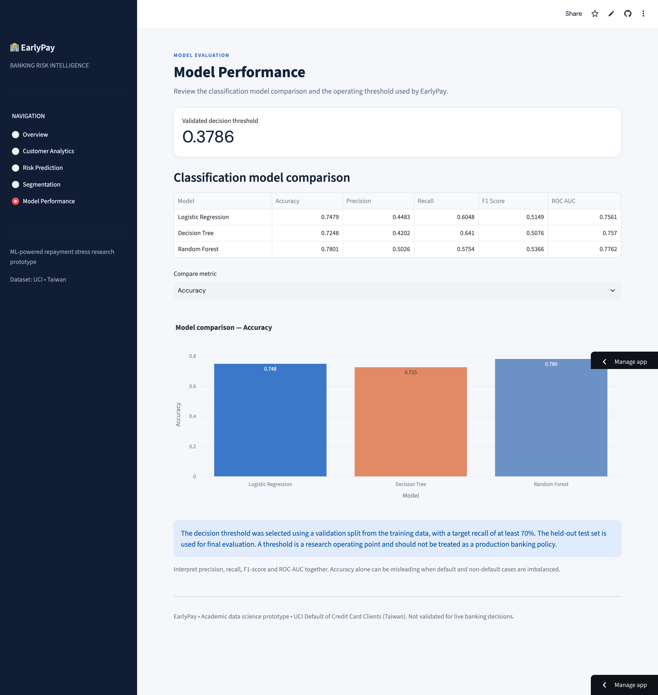

# EarlyPay – Banking Risk Intelligence Dashboard

**An ML-based early warning system for identifying emerging customer repayment stress.**

EarlyPay is an academic data science project that explores how machine learning can help identify credit-card customers who may be at risk of defaulting on their next payment.

The project combines predictive modelling, customer segmentation and interactive visual analytics in a Streamlit dashboard.

**Live Dashboard:** https://earlypay.streamlit.app

**GitHub Repository:** https://github.com/benisonbabu3-max/Earlypay-banking-risk-intelligence

## Problem Statement

Banks may identify repayment difficulties only after customers have missed payments. EarlyPay explores whether historical repayment behaviour, credit utilisation and billing patterns can help identify potential repayment risk earlier.

## Project Objectives

- Identify customers with patterns associated with future payment default.
- Compare multiple machine learning classification models.
- Explore customer repayment behaviour through segmentation.
- Present risk predictions and analytical insights through an interactive dashboard.

## Dashboard Features

1. **Overview** – Key customer and repayment-risk indicators.
2. **Customer Analytics** – Visual exploration of customer and repayment patterns.
3. **Risk Prediction** – Interactive form to estimate a customer's default probability and risk category.
4. **Segmentation** – Customer groups identified using K-Means clustering.
5. **Model Performance** – Comparison of model evaluation results.

## Machine Learning Methodology

### Classification
Models evaluated:
- Logistic Regression
- Decision Tree
- Random Forest

The final classification model uses a selected probability threshold to explore a higher-recall approach to identifying potential defaults.

### Regression
Models evaluated:
- Linear Regression
- Random Forest Regressor

The regression task estimates the most recent historical bill amount using earlier available information. It is not a future bill forecast.

### Customer Segmentation
K-Means clustering is used to group customers based on repayment behaviour, payment delays and credit utilisation.

## Dataset

The project uses the **Default of Credit Card Clients** dataset from the UCI Machine Learning Repository.

- Original observations: 30,000 customers
- Dataset location: Taiwan
- Source: UCI Machine Learning Repository
- DOI: https://doi.org/10.24432/C55S3H

The cleaned project dataset contains 29,965 records.

## Technology Stack

- Python
- Pandas
- NumPy
- Scikit-learn
- Streamlit
- Plotly
- Joblib
- Git and GitHub

## Run Locally

Clone the repository:

```bash
git clone https://github.com/benisonbabu3-max/Earlypay-banking-risk-intelligence.git
cd Earlypay-banking-risk-intelligence
```

Create and activate a virtual environment, then install dependencies:

```bash
python -m venv .venv
source .venv/bin/activate
pip install -r requirements.txt
```

Run the application:

```bash
streamlit run app.py
```

## Project Structure

```text
EarlyPay/
├── app.py
├── requirements.txt
├── data/
│   ├── raw/
│   └── processed/
├── models/
├── outputs/
└── README.md
```

## Important Limitations

- This is an academic research prototype, not a production banking system.
- The dataset represents credit-card customers in Taiwan, not Indian banking customers.
- The model has not been externally validated on live banking data.
- Risk predictions should not be treated as actual credit approval or rejection decisions.
- Feature importance indicates predictive contribution, not causation.

## Research Context

EarlyPay demonstrates how predictive analytics and machine learning can support early identification of repayment stress and help explore data-driven approaches to customer risk monitoring.

## Dashboard Screenshots

### 1. Overview


### 2. Customer Analytics


### 3. Risk Prediction


### 4. Customer Segmentation


### 5. Model Performance


**Developed as a MBA Banking Technology and Data Science portfolio project.**
